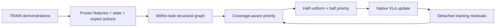

# Structural Manifold Adaptation (SMA)

**Structural Manifold Adaptation for Rapid VLA Fine-Tuning**  
**结构流形驱动的模型快速适配**

[中文说明](README.zh-CN.md) · [Algorithm](docs/algorithm.md) · [Integration](docs/integration.md)

SMA allocates a short fine-tuning budget to training windows using a structural
graph, recent coverage, and normalized learning residuals. It keeps the native
policy architecture and training objective unchanged. This repository extracts
the **S2** mechanism from our research implementation into a small NumPy package.



## What is included

- Four-block structural distance: frozen visual-language features, end-effector
  geometry, gripper descriptors, and valid expert action chunks.
- Task-local, gripper-phase-compatible regions and a diffusion kernel.
- The S2 feasible coverage target, bounded residual feedback and task caps.
- Exact 50/50 global batch allocation, sampling tickets, and JSON checkpoint state.
- A runnable CPU example, a native-trainer callback example, and reference tests.
- [Pi0.5 integration](integrations/pi05/README.md): pinned model setup, ordinary
  fine-tuning, SMA fine-tuning, native policy serving and paired evaluation code.

The lightweight core runs independently of model libraries. The Pi0.5 integration
adds actual model-specific feature/loss adapters and training/evaluation entry
points. Model weights, robot datasets and custom simulator assets are separate
inputs. The CPU example uses synthetic data and is not a performance benchmark.
SMA is a training method, not a new VLA backbone.

**S2** is the internal structural-sampler revision used in our experiments, not a
formal acronym. It corrects the coverage target to include the mandatory uniform
half of each batch. The public name is **SMA**.

## Quick start

Python 3.10+ and NumPy are sufficient; no GPU or model download is needed.

```bash
git clone https://github.com/diggerslab/Structural-Manifold-Adaptation.git
cd Structural-Manifold-Adaptation
python -m pip install -e '.[test]'
python -m sma.demo --output demo-output
python -m unittest discover -s tests -v
```

The demo builds a graph from 390 synthetic windows, runs eight allocation updates,
and checks exact next-draw restoration after a JSON checkpoint round trip. Outputs
include `summary.json` and `sampler-state.json`.

## Plug into a trainer

```python
from sma import SMASampler, build_graph

# All arrays and frozen features come from TRAIN only.
graph, report = build_graph(arrays, frozen_features)
# Evaluate the frozen initial model on the representative TRAIN windows.
initial_loss = score_initial_model(graph["representative_window_ids"])

sampler = SMASampler(
    episodes, graph["windows"], graph["regions"], graph["region_tasks"],
    graph["K"], initial_loss,
    priority_eligible=graph["priority_eligible"],
    global_batch_size=64,
)

ticket = sampler.draw()  # 32 uniform + 32 priority, then shuffled
batch = load_windows(ticket["episode_start"])
scores, valid_counts = native_train_step(batch)  # original objective, detached scores
sampler.observe(ticket, scores, valid_counts, fit_seconds=elapsed_seconds)
sampler.update_sampler(fit_seconds=elapsed_seconds)
```

The named loader/trainer callbacks above belong to your application. A complete
callback example is in [`examples/minimal_training_loop.py`](examples/minimal_training_loop.py).
For multiple GPUs, draw **once globally**, shard the ticket, gather scores in
ticket order, and update the sampler once. Do not run independent samplers on
each rank. The integration guide describes score normalization, feature
extraction, and prefetch-aware recovery.

## Why structure matters

Frames that look alike can require different actions. SMA's distance uses state
and expert action information as well as appearance, and disallows graph edges
between different tasks or incompatible gripper phases. Coverage is measured
on this graph rather than by raw frame counts alone. Half the batch remains
uniform to preserve coverage while the other half adapts its priorities.

“Manifold” denotes a **discrete structural approximation**. The method does not
recover a physical manifold, optimize a Wasserstein metric, add a representation
alignment loss, or change the policy at inference time. It does not guarantee
gains for every model or dataset.

## Reproducibility and scope

The reference setting is ten tasks, global batch 64, and a 10-step 7D action
chunk. The portable sampler also accepts other integer task IDs and positive
even batch sizes. The metric currently uses an 8D state schema; adapt that schema
explicitly for another embodiment.

Tests compare graph arrays, eight rounds of sampled indices and probabilities,
and residual/coverage updates against outputs generated by the original S2
functions on synthetic data. They also test phase barriers, padding, quaternion
sign invariance, bounded allocation, stale-score reset and checkpoint recovery.
See [provenance](docs/source-provenance.json). Numerical core parity does not
constitute a new end-to-end policy reproduction.

## Cost

One-time preparation encodes TRAIN observations with a frozen initial model,
constructs a small graph, and evaluates representative-window scores. Online
allocation runs on CPU and consumes detached scores from the native forward pass.
Report this preparation cost separately from training and evaluation. No new
inference module is introduced. Graph construction uses a dense candidate-distance
matrix within each task and dense eigendecomposition across regions; it is intended
for modest adaptation datasets rather than unbounded web-scale inputs.

## License

The code in this repository is released under the [MIT License](LICENSE).
External models, frameworks, and datasets retain their respective licenses.
